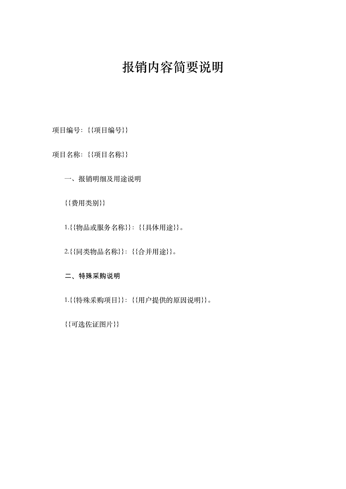

# expense

用于 Codex 的项目报销材料整理 Skill：统一发票与配套材料的文件名，并依据随附 Word 母版生成报销内容简要说明。

## 安装

将仓库克隆到 Codex 的 skills 目录：

```bash
git clone https://github.com/UEM-YJLAB/expense.git "${CODEX_HOME:-$HOME/.codex}/skills/expense"
```

## 使用

在 Codex 中调用：

```text
$expense
整理指定目录中的报销材料。
```

使用时提供姓名、项目编号、项目名称和材料所在目录；多人报销时同时确认发票的人员归属。Skill 会先整理材料，集中确认待补材料和用途，再生成正式 Word 说明。

## 整理规则

- 工作区按使用者姓名命名，一个项目对应一个工作区；多人发票汇总为一份说明。
- 发票命名为 `物品名称-姓名-价税合计.pdf`，金额保留两位小数。
- 单张发票价税合计达到或超过 200.00 元时，收集对应的订单截图和付款记录。
- 实物特殊采购的“无京东自营”原因由用户提供。
- 更新说明前，将旧版存入 `历史备份（旧版本，忽略）`。

上述要求来自本 Skill 的既定工作流程，具体项目要求可在使用时明确调整。完整规则见 [整理规则](references/整理规则.md)。

## 输出结构

```text
用户姓名/
├─ 发票/
├─ 订单截图/
├─ 付款记录/
├─ 历史备份（旧版本，忽略）/
└─ 报销内容简要说明.docx
```

四个目录始终保留，允许为空。正式说明按费用类别和用途汇总，省略人员明细、个人小计和金额总计。

## 随附资源

- [Skill 入口](SKILL.md)
- [信息采集表](assets/信息采集表.md)
- [Word 母版](assets/报销内容简要说明.docx)
- [Word 填写与更新](references/Word填写与更新.md)

生成 Word 说明时使用环境中可用的 documents 技能与文档运行时；读取发票时使用环境中可用的 PDF 能力。



